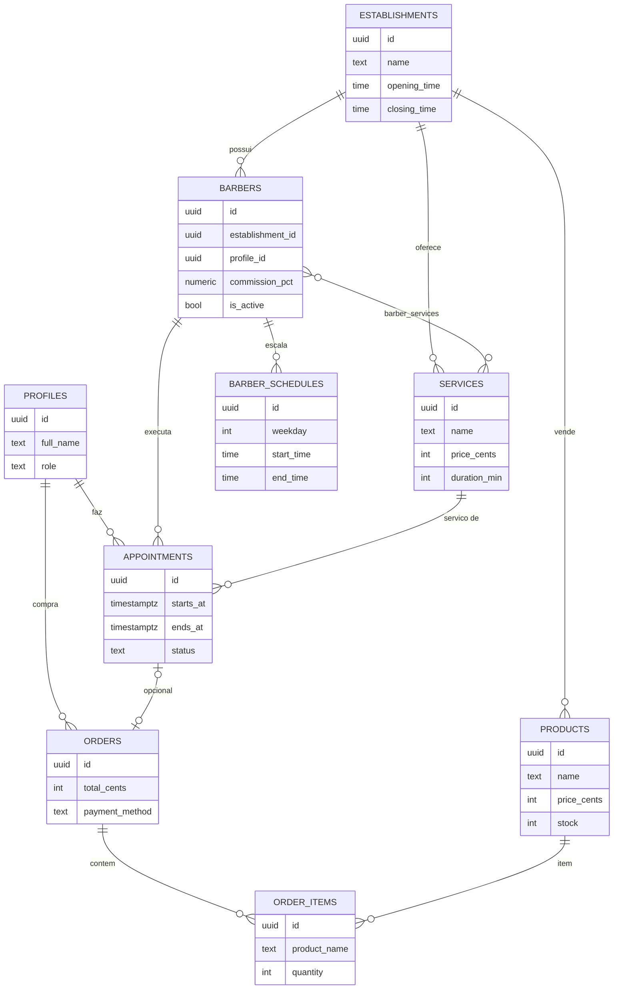

# 💈 BarberPro — Sistema completo para barbearias

    

Aplicação **ponta a ponta** para barbearias: **agendamento de atendimentos + venda de produtos (loja online e PDV) + painel administrativo completo**. No modelo **multi-espaço**, cada barbeiro independente é o administrador do próprio espaço (serviços, produtos, agenda e Pix), vários profissionais convivem na mesma instalação e um espaço pode ter múltiplos administradores convidados. Inclui **folgas pontuais**, **no-show**, **remarcação no painel**, **avaliações com nota**, **portfólio de fotos**, **favoritos**, **caixa com desconto e estorno**, **perfil público `/p/slug`**, **Pix antecipado** e **lembretes automáticos 24h** (WhatsApp/e-mail). Pronta para deploy no **Vercel** com **Supabase** (Postgres + Auth + RLS).

> Feita para o mercado brasileiro: preços em R$, fuso America/Sao_Paulo, pagamento no local (Pix/dinheiro/cartão) e botão de WhatsApp.

---

## ✨ Funcionalidades

### 👤 Área do cliente
| Recurso | Detalhe |
|---|---|
| Home, Serviços, Barbeiros e Loja | Páginas públicas com dados reais do estabelecimento |
| Agendamento em 4 passos | Serviço → Barbeiro → Dia → Hora, com horários calculados em tempo real |
| Anti-conflito à prova de corrida | Constraint no Postgres impede dois agendamentos do mesmo barbeiro no mesmo horário |
| Carrinho + checkout | Respeita estoque; baixa automática e atômica no banco (função `place_order`) |
| **Pagamento com Pix** | QR Code + "copia e cola" gerados na hora com a chave Pix da barbearia (padrão BR Code EMV do Banco Central — sem intermediários e sem taxas) |
| E-mails automáticos | Confirmação de agendamento, pedido e alterações de status (via Resend, opcional) |
| Minha conta | Próximos agendamentos, histórico, meus pedidos, **reagendamento**, cancelamento, edição de perfil e **troca de senha** |
| "Primeiro disponível" | O cliente não escolhe barbeiro: mostramos os horários de toda a equipe e o atendimento fica com quem tiver o encaixe |
| Busca na loja | Campo de busca por nome do produto |
| Cadastro/Login | E-mail + senha via Supabase Auth |
| WhatsApp flutuante | Usa o número cadastrado pela barbearia |

### 🛠 Painel admin (`/admin`)
| Recurso | Detalhe |
|---|---|
| Dashboard | KPIs do dia/mês (agendamentos, pendências, receita, estoque baixo), agenda do dia com ações rápidas e top serviços |
| Agendamentos | Filtros por dia/barbeiro/status; confirmar, concluir e cancelar; **novo agendamento manual** (telefone/balcão) com horários livres em tempo real |
| Barbeiros | CRUD completo, comissão, foto (**com upload do computador**), bio, **login vinculado**, serviços que executa e **escala semanal com até 2 janelas por dia** |
| Serviços | CRUD com preço e duração (alimentam o agendamento) |
| Produtos | CRUD com estoque, categoria e imagem (**upload direto via Supabase Storage**); destaque de estoque baixo |
| Vendas (PDV) | Lançamento rápido de vendas no balcão (avulsa ou vinculada ao cliente) com baixa de estoque + histórico de pedidos |
| Clientes (CRM) | Base de clientes com busca por nome/e-mail, nº de visitas, total gasto, última visita e últimos atendimentos |
| Relatórios | Receita do mês (serviços × produtos), **comissões por barbeiro** (prontas para o pagamento), top clientes, gráfico dos últimos 6 meses e **exportação CSV/Excel** |
| Configurações | Dados da barbearia: endereço, contato, horários, intervalo entre encaixes e **chave Pix** (habilita os QR Codes) + guia de promoção de admins |

### ✂️ Portal do barbeiro (`/barbeiro`)
Quando o admin vincula um login a um barbeiro, esse profissional ganha acesso próprio:

- **Agenda do dia** com nome/telefone do cliente, serviço e observações;
- **Confirmar** (pendente → confirmado) e **concluir** (→ finalizado) atendimentos com 1 clique;
- **Próximos 7 dias** agrupados por dia;
- **Comissão do mês** calculada na hora (receita × % dele);
- Políticas RLS próprias: o barbeiro só vê e mexe nos **seus** atendimentos — nunca pode cancelar nem ver os dos colegas.

---

## 🛠 Stack

- **Next.js 15** (App Router, Server Components, Server Actions) + **TypeScript**
- **Supabase** — Postgres, Auth (e-mail/senha), RLS e funções RPC
- **Tailwind CSS** (tema escuro premium âmbar/grafite)
- **Vercel** — deploy com 1 clique

## 🗄 Modelo de dados



**Segurança (RLS):** cada papel só faz o que deve —

| Tabela | Visitante | Cliente | Barbeiro | Admin |
|---|---|---|---|---|
| serviços, barbeiros, produtos, escalas | lê ativos | lê ativos | lê ativos | tudo |
| agendamentos | — | cria/cancela/reagenda os próprios | vê e confirma/conclui os seus | tudo |
| pedidos | — | vê os próprios (checkout via RPC segura) | — | tudo |
| perfis | — | edita o próprio (sem mudar papel) | lê os seus clientes | tudo |

Funções e guardas no banco:
- `get_available_slots(barbeiro, data, duracao)` — cruza escala × agendamentos ativos, fuso SP;
- `place_order(itens, cliente, pagamento)` — valida estoque, baixa e cria o pedido numa única transação;
- `appointments_no_overlap` — constraint de exclusão que impede agendamento duplicado mesmo sob concorrência;
- trigger de cadastro cria o perfil automaticamente e promove a **admin** quem estiver em `admin_emails`.

---

## 🚀 Colocando no ar (guia completo)

### 1. Criar o projeto no Supabase
1. Acesse [supabase.com](https://supabase.com) → **New project**;
2. Escolha região e senha do banco (a senha não é usada pelo app);
3. Aguarde provisionar.

### 2. Rodar o schema SQL
- No painel do Supabase abra **SQL Editor** → **New query**;
- Cole TODO o conteúdo de [`supabase/migrations/0001_schema.sql`](supabase/migrations/0001_schema.sql) → **Run**;
- Repita com [`supabase/migrations/0002_barber_portal.sql`](supabase/migrations/0002_barber_portal.sql) (portal do barbeiro + reagendamento) → **Run**;
- E com [`supabase/migrations/0003_pix_storage.sql`](supabase/migrations/0003_pix_storage.sql) (chave Pix + bucket de imagens) → **Run**;
- E com [`supabase/migrations/0004_multi_workspace.sql`](supabase/migrations/0004_multi_workspace.sql) (**multi-espaço**: cada barbeiro é admin do próprio espaço; RLS por espaço; `create_workspace`) → **Run**;
- E com [`supabase/migrations/0005_new_features.sql`](supabase/migrations/0005_new_features.sql) (**novos recursos**: folgas pontuais, portfólio, avaliações, favoritos, no-show, desconto/estorno no PDV, perfil público `/p/slug`, lembretes 24h, Pix antecipado) → **Run**;
- E com [`supabase/migrations/0006_master_control.sql`](supabase/migrations/0006_master_control.sql) (**controle master**: cadastro de espaços/barbeiros exclusivo do administrador master; auto-cadastro de profissional desligado) → **Run**;
- E com [`supabase/migrations/0007_company_hierarchy.sql`](supabase/migrations/0007_company_hierarchy.sql) (**hierarquia em 3 níveis**: empresas (`is_company`) agrupam espaços de profissionais (`parent_id`); 1º barbeiro vira gerenciador da empresa) → **Run**;
- E com [`supabase/migrations/0008_presentation.sql`](supabase/migrations/0008_presentation.sql) (**apresentação configurável**: 3 layouts de site por barbeiro + banner, nome de exibição e frase) → **Run**;
- (Opcional) Cole também o [`supabase/seed.sql`](supabase/seed.sql) para dados de demonstração — **edite-o antes e troque o e-mail pelo seu** (linha do `admin_emails`).

### 3. Promover você a administrador da PLATAFORMA
Escolha UMA das opções (rode no SQL Editor):

- **Antes de se cadastrar:**

```sql
insert into public.admin_emails (email) values ('seu-email@exemplo.com');
```

  Depois de se cadastrar no site com esse e-mail, a conta já nasce admin.

- **Conta já existente:**

```sql
update public.profiles set role = 'admin' where email = 'seu-email@exemplo.com';
```

### 3b. Como funciona o controle master (modelo atual)
- **Só o administrador master cria profissionais.** O registro público do site cria apenas contas de **cliente**; barbeiros entram por convite.
- **Painel Master** (`/admin/master`, exclusivo do master): cadastra barbeiros com **login e senha**, define **onde cada um trabalha** (local novo ou copiado de um espaço existente), remove/reativa acessos e gerencia qualquer espaço da plataforma.
- **Cada barbeiro tem operação independente**: espaço próprio (serviços, preços, produtos, estoque, Pix, clientes, vendas e relatórios), isolado por RLS — mesmo local físico compartilhado.
- **E-mails em `admin_emails` são masters da plataforma** (a sua conta). Requer `SUPABASE_SERVICE_ROLE_KEY` no `.env.local` para o Painel Master criar logins (a mesma chave usada pelo cron de lembretes).
- **Um espaço ainda pode ter administradores extras**: em *Configurações → Administradores do espaço*.
- **Clientes**: navegam por profissional (o wizard começa pedindo o profissional) e veem cada espaço no site, na loja e nos Pix gerados.

### 4. Facilitar o login em desenvolvimento
Painel → **Authentication** → **Sign In / Providers** → **Email**: desligue **Confirm email** (para não depender de e-mail de confirmação; reative em produção se quiser).

Em **Authentication → URL Configuration**, adicione as **Site URL / Redirect URLs** do seu ambiente (ex.: `http://localhost:3000/**` e o domínio de produção) — é o que permite o fluxo de **"Esqueci minha senha"** funcionar.

### Site do barbeiro: 3 layouts configuráveis
Em *Configurações → Site e apresentação*, cada profissional escolhe como o SEU site aparece:
- **Layout 1 — Clássico**: banner ao centro com foto redonda sobreposta, nome serif gigante, tagline âmbar e seções simétricas;
- **Layout 2 — Painel**: lateral fixa com foto, nome empilhado e contatos (banner no fundo); serviços rolam ao lado em linhas com preço pontilhado, seções numeradas (01, 02, 03);
- **Layout 3 — Editorial**: banner full-bleed estilo capa de revista com nome enorme, menu de cortes com preços grandes e citações de avaliação destacadas.

Também configura **banner** (upload até 4MB), **nome de exibição** e **frase de apresentação**. Sem banner, o site usa o fundo padrão. Os três barbeiros demo ficam com um layout diferente cada (após a migration 0008).

### Hierarquia em 3 níveis: plataforma → empresas → profissionais
- **Site principal** (`SEUDOMINIO`): diretório das **empresas** cadastradas (Painel Master → Empresas).
- **Site da empresa** (`{empresa}.SEUDOMINIO`): endereço/horários da unidade + os **profissionais que trabalham nela**, cada um com link para o site próprio.
- **Site do profissional** (`{nome}.SEUDOMINIO`): serviços, portfólio, avaliações e agendamento dele — sem nunca mostrar concorrentes.
- Ao cadastrar um barbeiro numa empresa, o **primeiro** vira **gerenciador dela**: no painel dele aparece **"Minha empresa"** (`/admin/empresa`), onde edita os dados como preferir e **adiciona gerenciadores por e-mail** (só aceita logins de barbeiros vinculados à empresa).

### Sites por subdomínio (um endereço para cada profissional)
Cada espaço ganha um **site próprio** no subdomínio igual ao slug dele — `lucas.seudominio.com.br` mostra **só o Lucas**: landing com foto, nota, serviços, portfólio e avaliações; o agendamento já entra travado nele; a loja exibe apenas os produtos dele. Nenhum concorrente aparece (nem no HTML invisível). O domínio principal continua sendo a plataforma com todos.

Para ativar:
1. Configure `NEXT_PUBLIC_ROOT_DOMAINS=seudominio.com.br,localhost` no `.env.local` **e** nas variáveis da Vercel (o `localhost` permite testar com `http://lucas.localhost:3000`);
2. Na Vercel: **Settings → Domains → Add** para cada subdomínio (ex.: `lucas.seudominio.com.br`);
3. No DNS do seu provedor: registro **CNAME** de `lucas` para `cname.vercel-dns.com`;
4. O link de divulgação aparece no **Painel Master → Espaços**.

O slug do espaço é o endereço: ajuste em *Configurações → Endereço do perfil público* (só letras minúsculas, números e hífens). Subdomínio desconhecido mostra uma página "site não encontrado" — sem vazar a plataforma.

#### Opcionais pós-migração 0005
- **Lembretes 24h**: configure `SUPABASE_SERVICE_ROLE_KEY` (Settings → API) e `CRON_SECRET` no `.env.local` — o cron diário (09:00 de Brasília) já vem agendado no `vercel.json` e chama `/api/cron/lembretes`.
- **WhatsApp automático** (confirmações, lembretes, aviso de novo agendamento): configure `WHATSAPP_API_URL` e `WHATSAPP_API_TOKEN` com um gateway compatível (ex.: Z-API). Sem gateway, os avisos caem só no e-mail e os links wa.me continuam funcionando.

### 5. Rodar localmente

```bash
# instale as dependências
npm install

# configure as variáveis
cp .env.example .env.local
# ...edite .env.local com a URL e a chave anon do seu projeto (Settings -> API)
#
# OPCIONAL — e-mails automáticos via https://resend.com (plano grátis):
# RESEND_API_KEY=re_xxx
# EMAIL_FROM=BarberPro <naoresponda@seudominio.com>
# Sem essas variáveis o app funciona 100%; os e-mails simplesmente não são enviados.

# suba o servidor
npm run dev
```

Abra [http://localhost:3000](http://localhost:3000).

### 6. Deploy no Vercel
1. Suba este repositório para o GitHub;
2. No [vercel.com](https://vercel.com) → **Add New Project** → importe o repo;
3. Adicione as variáveis de ambiente:
   - `NEXT_PUBLIC_SUPABASE_URL`
   - `NEXT_PUBLIC_SUPABASE_ANON_KEY`
   - `NEXT_PUBLIC_APP_NAME` (opcional) e `NEXT_PUBLIC_SITE_URL` (URL final, para o sitemap)
4. **Deploy** — pronto. O `vercel.json` já está incluído.

> 💡 Dica: instale a integração **Supabase for Vercel** no marketplace do Vercel — ela injeta as variáveis automaticamente.

### 7. Configurar a barbearia
Acesse `/admin/configuracoes`, preencha os dados da barbearia e cadastre **Barbeiros** (escala semanal + serviços), **Serviços** e **Produtos**. O site reflete tudo em tempo real.

---

## 📁 Estrutura do projeto

```text
app/
├── (public)/          # área do cliente
│   ├── page.tsx       # home
│   ├── servicos/      # lista de serviços
│   ├── barbeiros/     # equipe
│   ├── loja/          # produtos
│   ├── carrinho/      # checkout
│   ├── agendar/       # wizard de agendamento (4 passos)
│   ├── entrar/ | registrar/
│   └── minha-conta/   # agendamentos + pedidos + perfil
├── admin/             # painel administrativo (protegido)
│   ├── page.tsx       # dashboard
│   ├── agendamentos/  # filtros + ações + novo manual
│   ├── barbeiros/     # CRUD + escala semanal
│   ├── servicos/      # CRUD
│   ├── produtos/      # CRUD + estoque
│   ├── vendas/        # PDV + histórico
│   ├── clientes/      # CRM (busca, visitas, gasto)
│   ├── relatorios/    # receita, comissões, export CSV
│   └── configuracoes/ # barbearia + guia de admins
├── barbeiro/          # portal do barbeiro (agenda própria)
├── api/export/        # exportação CSV (admin)
├── actions/           # server actions (auth, booking, orders, admin)
├── components/        # UI (carrinho, wizard, formulários, badges...)
├── lib/               # supabase clients, tipos, timezone SP, utils
└── supabase/
    ├── migrations/0001_schema.sql   # schema + RLS + funções
    └── seed.sql                     # dados demo (opcional)
```

## ⚙️ Detalhes técnicos

- **Fuso fixo America/Sao_Paulo (UTC-3):** escala, slots e exibição usam este fuso — sem depender do fuso do servidor;
- **Carrinho:** persistido em `localStorage`; a validação de verdade (estoque/preço) acontece na função `place_order`, no banco;
- **Sem service_role no app:** o site usa apenas a chave **anon** — toda escrita passa por RLS ou RPC segura;
- **Preços em centavos (inteiros)** para evitar erros de ponto flutuante;
- **SEO:** `robots.txt`, `sitemap.xml` e manifest incluídos.
- **Pix nativo:** o "copia e cola" é montado localmente ([`lib/pix.ts`](lib/pix.ts), padrão EMV + CRC16 verificado contra o vetor oficial) com a chave Pix da barbearia — sem gateway e sem taxa. O QR Code é gerado **no servidor** ([`lib/qr.ts`](lib/qr.ts)) e enviado pronto ao navegador.
- **Uploads:** imagens de produtos/barbeiros vão para o bucket público `media` do Supabase Storage; apenas admins podem gravar (policies RLS na migration 0003).

## 🗺 Roadmap (ideias)

- [x] ~~Portal do barbeiro~~ ✅
- [x] ~~Relatórios + comissões + export CSV~~ ✅
- [x] ~~Reagendamento + "primeiro disponível"~~ ✅
- [x] ~~Notificações por e-mail (Resend)~~ ✅
- [x] ~~Pagamento online (Pix nativo, sem taxas)~~ ✅
- [x] ~~Upload de imagens (Supabase Storage)~~ ✅
- [ ] Cartão de crédito via Stripe/Mercado Pago com webhook
- [ ] Lembretes por WhatsApp (exige WhatsApp Business API)
- [ ] Multi-estabelecimento com seleção por subdomínio

## 📄 Licença

MIT — veja o arquivo [LICENSE](LICENSE).
